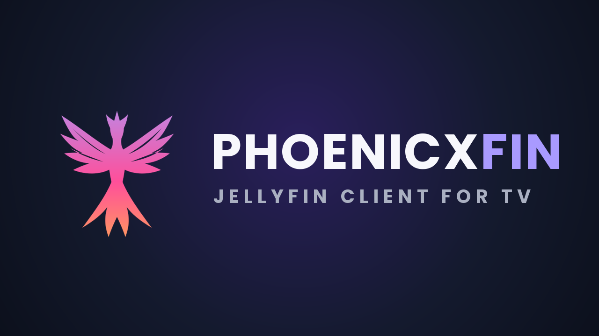

<p align="center">
  
</p>

<p align="center">
  <b>A beautiful, remote-friendly Jellyfin client for Fire TV and Android TV,<br>
  with full support for your server's custom CSS themes and web plugins.</b>
</p>

<p align="center">
  <a href="../../releases/latest"></a>
  <a href="../../releases"></a>
  <a href="LICENSE.md"></a>
  
</p>

---

## What is Phoenicxfin?

The official Jellyfin app for Fire TV is a separate, native app. It **ignores custom CSS themes and web plugins**, so your TV never looks like Jellyfin does in your browser, on your phone or in Jellyfin Media Player.

Phoenicxfin fixes that. It runs the **same Jellyfin web interface** as your other devices, in Jellyfin's TV layout, and adds everything needed to use it comfortably with a TV remote:

- 🎨 **Your theme, on your TV.** Custom CSS from *Dashboard → General → Custom CSS* works exactly like it does in the browser.
- 🧩 **Web plugins work too.** Home-screen slideshows, custom home sections and other plugins that add to the web interface show up on the TV.
- 🎯 **Always know what's selected.** A glowing violet focus ring follows the remote.
- 🖱️ **Pointer mode.** Press **☰ Menu** for an on-screen cursor that can reach buttons the arrow keys can't.
- ▶️ **Native video player.** Videos play in the same hardware-accelerated player (Media3 / ExoPlayer) as the official Jellyfin phone app, with full remote control.
- 📺 **Made for the big screen.** Home-screen banner, no touch-only prompts, no picture-in-picture surprises.
- 🤝 **Installs next to the official Jellyfin app.** Use both if you like.

## Install

### Fire TV / Fire TV Stick
1. **Settings → My Fire TV → Developer options → Install unknown apps**, and turn it on for **Downloader**.
   (If you don't see *Developer options*, go to **Settings → My Fire TV → About** and click your device name 7 times.)
2. Install **Downloader** (by AFTVnews) from the Amazon Appstore.
3. Open Downloader and enter:
   ```
   https://github.com/hansonds/Phoenicxfin/releases/latest/download/Phoenicxfin.apk
   ```
4. Install, then open **Phoenicxfin** from *Your Apps & Channels*.

### Android TV / Google TV
Download `Phoenicxfin.apk` from the [latest release](../../releases/latest) and sideload it (for example with Downloader or *Send Files to TV*).

### First start
Enter your Jellyfin server address (for example `https://jellyfin.example.com` or `http://192.168.1.10:8096`), then sign in. Servers on your home network usually show up automatically.

### Updating
Install the new APK over the old one. Your login and settings are kept.

## Remote controls

**Browsing**

| Button | Action |
|---|---|
| ◀ ▲ ▶ ▼ | Move between items |
| OK | Open / select |
| Back | Go back (exits the app on the home screen) |
| ☰ Menu | Turn the pointer on or off |

**Pointer mode** (after pressing ☰)

| Button | Action |
|---|---|
| ◀ ▲ ▶ ▼ | Move the pointer (hold to speed up; push against an edge to scroll) |
| OK | Click |
| Back or ☰ | Turn the pointer off |

**Video player**

| Button | Controls hidden | Controls showing |
|---|---|---|
| OK | Play / pause (or **Skip Intro** when shown) | Press the selected button |
| ◀ ▶ | Jump back / forward | Move between buttons, or scrub when the progress bar is selected |
| ▲ ▼ | Show controls | Move between buttons |
| ⏯ ⏪ ⏩ | Play/pause, rewind, fast-forward | Same |
| ☰ Menu | Show controls on **Subtitles** | |
| Back | Leave the video | Hide the controls |

## Works with custom CSS

Phoenicxfin loads the Jellyfin web interface straight from your server, so **any custom CSS saved on your server is applied automatically**. That includes CSS loaded with `@import` from GitHub or jsDelivr, and themes such as ElegantFin, Ultrachromic, JellySkin, Finity and [PHOENICX CINEMA](https://github.com/hansonds/Phoenicx-Cinema-Theme). There's nothing to set up in the app.

Phoenicxfin's own additions are small and only appear on focused items: the violet focus glow and the pointer. They don't change how your theme looks otherwise.

### Tips for theme authors and tinkerers
- **Phoenicxfin always uses Jellyfin's TV layout.** Jellyfin puts the class `layout-tv` on the page, so you can write TV-only rules:
  ```css
  .layout-tv .card { /* only on TVs */ }
  ```
  Themes that only style the desktop or mobile layouts may look slightly off on a TV.
- **Use `:focus`, not just `:hover`.** A remote moves *focus*, it doesn't hover. Effects that only appear on hover won't show up (except in pointer mode).
- **Go easy on heavy effects.** Lots of `backdrop-filter: blur()`, large shadows and constant animations can make scrolling stutter on a Fire TV Stick. If your theme feels slow, try disabling blur for TVs:
  ```css
  .layout-tv * { backdrop-filter: none !important; -webkit-backdrop-filter: none !important; }
  ```
- **Keep focus outlines visible.** If your theme removes outlines, the remote becomes hard to follow. Phoenicxfin adds its glow back for the most common elements.
- **The video player can't be themed.** Videos play in the native player for smooth 4K/HDR playback, so CSS doesn't change the playback screen. Everything else is themed.

## Phoenicxfin vs. the official Jellyfin TV app

| | Phoenicxfin | Official Jellyfin Android TV |
|---|---|---|
| Custom CSS themes | ✅ Yes | ❌ No |
| Web interface plugins | ✅ Yes | ❌ No |
| Looks the same as browser / phone / Media Player | ✅ Yes | ❌ Different design |
| Pointer for hard-to-reach buttons | ✅ Yes | ❌ No |
| Native video player | ✅ Media3 / ExoPlayer | ✅ Media3 / ExoPlayer |
| Scrolling speed on low-end sticks | Good (depends on your theme) | ✅ Fastest |
| Navigation polish | Good, with pointer as a fallback | ✅ Built only for remotes |

**Choose Phoenicxfin** if you want your themed Jellyfin on the TV. **Choose the official app** if raw speed on a very low-end device matters most. They install side by side, so you can try both.

## Requirements
- Fire TV / Fire TV Stick (Fire OS 6 or newer) or Android TV / Google TV (Android 6.0 or newer)
- A Jellyfin server that the official Jellyfin Android app supports
- An up-to-date Android System WebView (Fire TV updates this automatically)

## Troubleshooting

<details>
<summary><b>Scrolling feels slow or stutters</b></summary>

Usually caused by heavy theme effects (blur and big shadows). Try the TV-only "no blur" CSS above, or test with custom CSS temporarily removed.
</details>

<details>
<summary><b>I can't reach a button with the arrow keys</b></summary>

Press **☰ Menu** to turn on the pointer, move to the button and press **OK**. Some theme or plugin elements aren't reachable with the arrow keys.
</details>

<details>
<summary><b>A video won't play or has no sound</b></summary>

Some formats (certain audio codecs or subtitle types) can't be played directly by the device. Make sure transcoding is allowed for your user on the server (*Dashboard → Users → your user → Media playback*).
</details>

<details>
<summary><b>The layout looks like the phone version</b></summary>

Open the user menu → *Display* and set *Display mode* to **TV**, then restart the app.
</details>

<details>
<summary><b>The app shows "Connection error"</b></summary>

Check the server address, including `http://` or `https://` and the port. If the server is outside your home, make sure it's reachable from the TV's network.
</details>

## Build it yourself

Phoenicxfin is the official [Jellyfin Android](https://github.com/jellyfin/jellyfin-android) app with a small set of changes, kept in [`phoenicxfin.patch`](phoenicxfin.patch). The GitHub Actions workflow downloads the matching official release, applies the patch and builds a signed APK.

To build your own copy:
1. Fork this repository.
2. Create a signing key: `keytool -genkeypair -keystore phoenicxfin.jks -alias phoenicxfin -keyalg RSA -keysize 4096 -validity 36500 -storetype PKCS12`
3. Add two repository secrets (*Settings → Secrets and variables → Actions*):
   - `KEYSTORE_BASE64`: the key file, base64 encoded (`base64 -w0 phoenicxfin.jks`)
   - `KEYSTORE_PASSWORD`: the key's password
4. Run the **Build Phoenicxfin** workflow in the *Actions* tab. The APK appears under *Releases*.

**What the patch changes**
- Starts the web interface in Jellyfin's TV layout and gives it remote focus
- Adds `phoenicxfin-tv.js`: the focus glow and pointer mode
- Adds remote handling to the native player (seek, play/pause, skip intro, Back to hide controls)
- Adds the Fire TV / Android TV launcher entry, banner and phoenix icon
- Turns off phone-only behaviour on TVs (picture-in-picture, battery prompt, rotation and lock buttons)
- Uses its own app ID (`org.phoenicx.phoenicxfin`) so it installs next to the official app

## Credits

**Phoenicxfin is created and maintained by [Hanson (@hansonds)](https://github.com/hansonds).**
Logo, name and the TV-focused design are by Hanson. Also by Hanson: the [PHOENICX CINEMA](https://github.com/hansonds/Phoenicx-Cinema-Theme) Jellyfin theme.

Phoenicxfin is built on the work of others:
- **[Jellyfin](https://jellyfin.org)** and the **[Jellyfin Android](https://github.com/jellyfin/jellyfin-android)** contributors. Phoenicxfin is based on their app and their web interface.
- **[AndroidX Media3 / ExoPlayer](https://github.com/androidx/media)** for video playback
- All the open-source libraries used by Jellyfin Android

If you like Phoenicxfin, please ⭐ star the repo, and consider [supporting the Jellyfin project](https://opencollective.com/jellyfin).

## License

Phoenicxfin is free software, licensed under the **[GNU General Public License v2.0](LICENSE.md)**, the same license as Jellyfin Android. The complete source is in this repository: the official Jellyfin Android release named in the workflow plus `phoenicxfin.patch`.

Phoenicxfin is an independent project. It is **not affiliated with or endorsed by the Jellyfin project**. "Jellyfin" is used only to describe compatibility.
